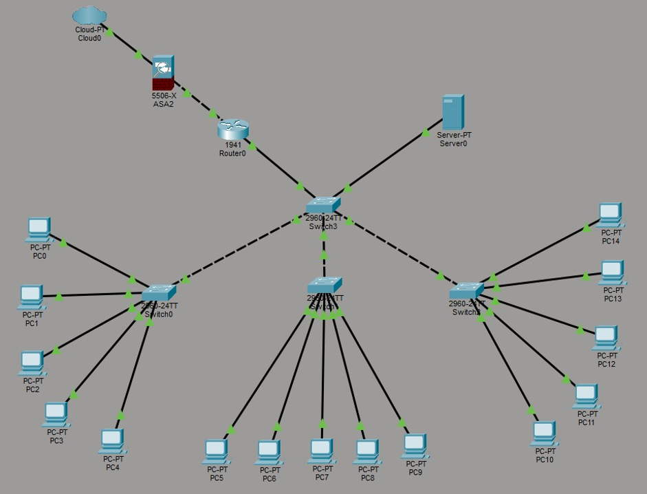
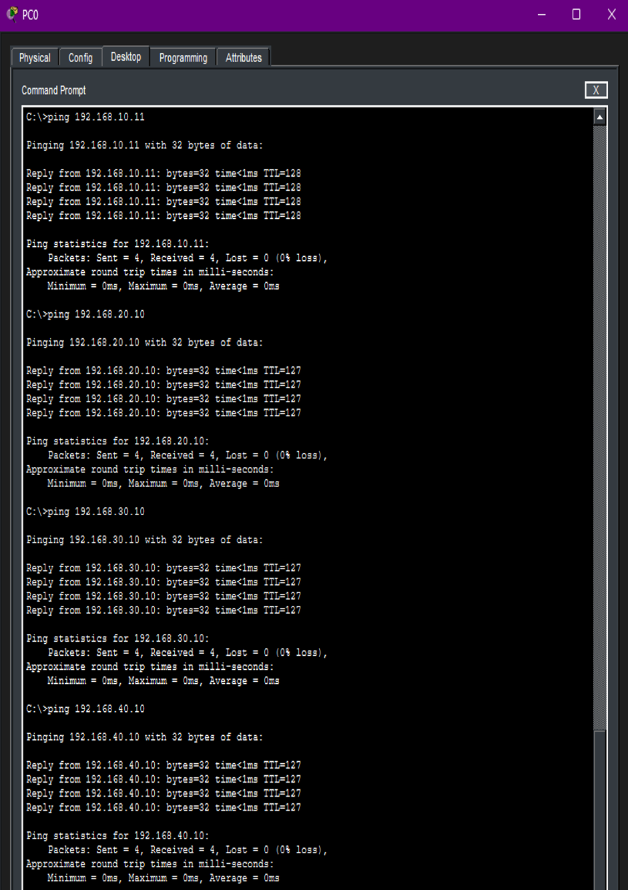

# Building a segmented network in Cisco Packet Tracer

A university lab project where I designed a small client server network and tested it end to end. This page explains what I built, why I made each choice and what I learned.

## What I built

A network with 15 PCs, one server, three switches, a router and a firewall. I split it into four VLANs so devices are separated into groups instead of sitting on one flat network. The router joins the VLANs back together so they can still talk when they need to.

## Why I segmented it

On a flat network every device hears every broadcast and one compromised machine can see far more than it should. Separate VLANs keep that traffic apart. The server got its own VLAN because in real networks important services are kept away from everyday user machines.

## How I did the addressing

Each VLAN has its own /27 subnet. The maths behind it:

| Step | Working | Result |
|---|---|---|
| Host bits in a /27 | 32 minus 27 | 5 |
| Total addresses | 2 to the power of 5 | 32 |
| Usable hosts | 32 minus network and broadcast | 30 |

Thirty hosts per VLAN is plenty for five PCs and leaves room to grow without wasting a whole /24. I used static IPs so every device has a predictable address and a rogue DHCP server can't hand out the wrong details. The downside is that it doesn't scale, so on a bigger network I'd use DHCP and protect it properly.

I also left the 192.168.1.0 range alone because lots of home devices default to 192.168.1.1 and I wanted to avoid clashes.

## How the VLANs talk to each other

I used router on a stick. One link from the switch to the router carries all the VLANs and the router has a subinterface for each one using 802.1Q tagging. It's a simple way to get inter VLAN routing without needing a separate router port for every VLAN.

## Why switches and not hubs

A hub sends every frame out of every port so anyone plugged in can capture everyone else's traffic with a tool like Wireshark. A switch learns which MAC address sits on which port and only sends frames where they need to go. As a security student it was a good reminder that network design choices are security choices too.

## How I tested it

I pinged between PCs in different VLANs and to the server from three different starting points so I wasn't only checking one path. The first ping in each test timed out. That was ARP resolving and it's normal. After that I got 0% packet loss everywhere which told me the cabling and the routing were both right.

The rest of the pings are not in here.

## What I learned

Subnetting clicks much faster when you actually build something with it. The testing also taught me more than the setup did because you only really understand why something works once you've seen it fail first.

## What I'd add next

- ACLs between VLANs so each group only reaches what it needs
- Port security on the switch ports
- DHCP with snooping instead of static addressing
- Packet captures to show hub vs switch behaviour
